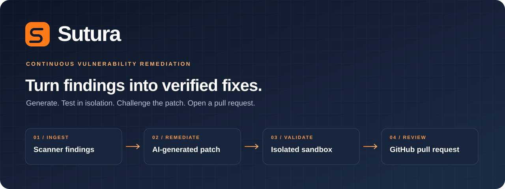
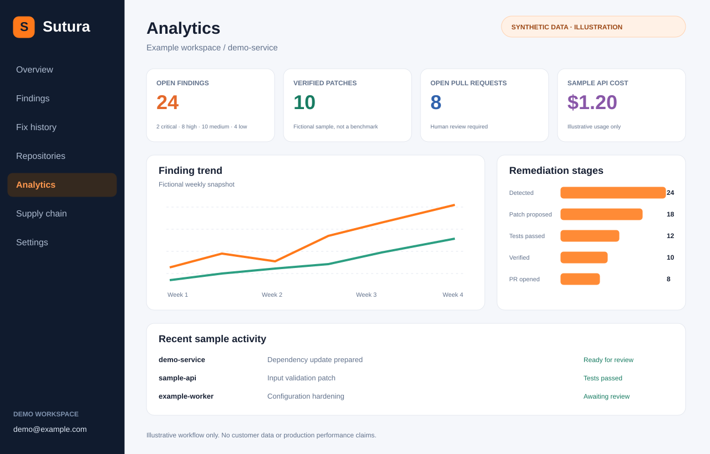
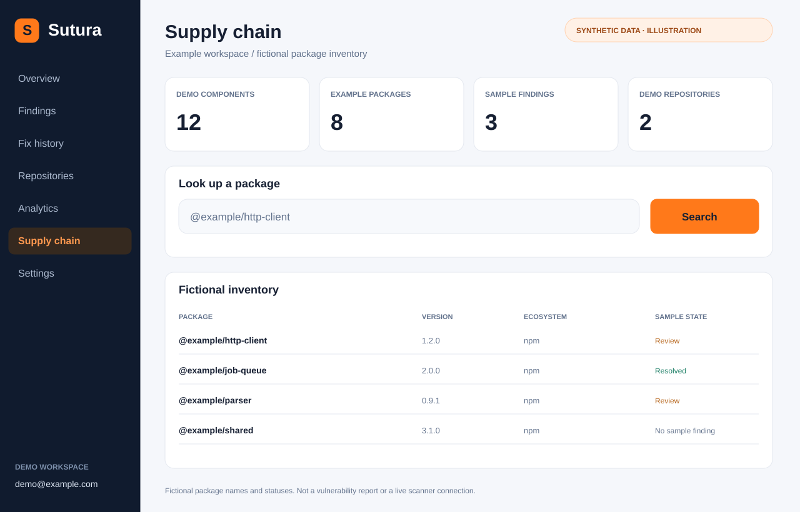
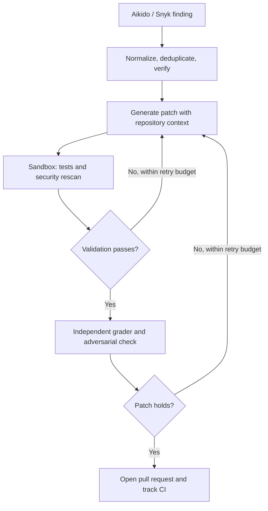

<div align="center">



<br />

**Self-hosted vulnerability remediation, from scanner finding to pull request.**

Connect your security scanners to an AI pipeline that generates patches,
tests them in disposable sandboxes, and opens pull requests for review.

[](package.json)
[](apps/dashboard/package.json)
[](LICENSE)
[](deploy/azure/README.md)

[Previews](#previews) · [Quick start](#quick-start) · [First remediation](#your-first-remediation) · [Architecture](#architecture) · [Setup guide](docs/guides/getting-started.md)

</div>

---

## What Sutura does

Security scanners identify problems. Sutura handles the next step: turning a finding into a patch with evidence that a reviewer can inspect.

| Capability            | How it works                                                                                  |
| --------------------- | --------------------------------------------------------------------------------------------- |
| Collect findings      | Aikido and Snyk integrations, webhooks, and optional outbound synchronization                 |
| Verify and prioritize | Normalize and deduplicate findings; assess whether vulnerabilities are real and reachable     |
| Generate a fix        | Claude-powered agents use repository context and optional retrieval via Pinecone and Voyage   |
| Validate the patch    | Apply changes, restore dependencies, run configured tests, and rescan in a disposable sandbox |
| Challenge the result  | A separate grader and adversarial agent check the proposed remediation                        |
| Deliver for review    | Open a GitHub PR with patch context and validation details; track CI status                   |
| Follow the work       | Findings, fix history, analytics, token costs, supply-chain lookup, and audit views           |

**Project status:** an implemented MVP with local tests and sandbox rehearsals. The hardened Linux/gVisor configuration and the complete live scanner → patch → PR flow still require end-to-end validation. Available gates depend on the repository's configured toolchain; repositories without a test command do not receive a build/test guarantee.

## Previews

Illustrative interface previews built with synthetic data. These are not screenshots of a live deployment, customer data, benchmark results, or current security reports.

### Analytics and remediation progress



<details>
<summary><strong>View the supply-chain workspace</strong></summary>

<br />



</details>

## How it works



Attempts have time and token budgets. Review the patch alongside its test, scan, and CI results before merging.

## Quick start

### 1. Get the code

You need Git and Docker with Compose. For host-based development, use a maintained Node.js LTS release compatible with the dependencies, preferably Node.js 24, and npm. The package currently declares `>=20`; that is a compatibility floor, not a recommendation to deploy an end-of-life runtime.

```bash
git clone https://github.com/junque1r4/sutura-remediation.git
cd sutura-remediation
cp .env.example .env
```

### 2. Configure local access

In `.env`, replace these four placeholders with **different** secrets. Run `openssl rand -hex 32` separately for each value. Never commit the resulting `.env`.

```dotenv
JWT_SECRET=<unique-random-secret>
INTEGRATION_ENCRYPTION_KEY=<unique-random-secret>
POSTGRES_PASSWORD=<unique-random-secret>
REDIS_PASSWORD=<unique-random-secret>
```

Compose supplies the container database and Redis URLs using those passwords. When running the apps directly on the host, update `DATABASE_URL` and `REDIS_URL` in `.env` to match too.

Add your first owner account to the same `.env` file:

```dotenv
BOOTSTRAP_OWNER_EMAIL=you@example.com
BOOTSTRAP_OWNER_PASSWORD=<your-own-strong-password>
```

The dashboard creates that account at startup if it does not already exist. Changing the bootstrap password later does **not** reset an existing user's password.

### 3. Start the application

```bash
docker compose up -d --build
docker compose ps
curl -fsS http://localhost:3001/health
```

The backend applies database migrations at startup. Open **http://localhost:3000/login** and sign in with the owner account you configured. The API listens on port **3001**.

For startup diagnostics:

```bash
docker compose logs --tail=100 backend dashboard
```

### 4. Prepare sandbox images before running fixes

For local development on macOS/Docker Desktop:

```bash
SKIP_RUNSC=1 SKIP_PROXY=1 ./scripts/setup-sandbox.sh
```

This builds the language images and creates the sandbox network. Compose supplies the socket proxy. Local development uses `runc`; production requires Linux with gVisor (`runsc`). Image builds download toolchains and can take several minutes and substantial disk space.

## Your first remediation

1. In **Settings**, connect your scanner, Anthropic, and GitHub integration. GitHub needs a configured GitHub App; see the variables below.
2. Select a repository you control and configure its toolchain/build/test instructions where necessary. Start with a small test repository and a reproducible finding.
3. Pull findings with **Sync now** on the Findings page, or enable periodic synchronization.
4. Inspect a finding and start a validated fix. Claude calls incur API usage costs.
5. Follow the attempt in **Fix History**. Review the diff, validation evidence, pull request, and downstream CI before merging.

For persistent findings rather than live scanner reads, set these in `.env`, then rebuild the dashboard because the `NEXT_PUBLIC_*` setting is baked into its bundle:

```dotenv
SCANNER_SYNC_ENABLED=true
NEXT_PUBLIC_FINDINGS_FROM_DB=true
```

```bash
docker compose up -d --build
```

## Configuration reference

See [`.env.example`](.env.example) for the baseline and [the production template](deploy/azure/.env.production.template) for deployment settings.

| Setting                                                                           | Purpose                                                                  |
| --------------------------------------------------------------------------------- | ------------------------------------------------------------------------ |
| `DATABASE_URL`, `REDIS_URL`                                                       | Connections for host-based execution; Compose sets container equivalents |
| `JWT_SECRET`, `INTEGRATION_ENCRYPTION_KEY`                                        | Service authentication and encrypted integration credentials             |
| `POSTGRES_PASSWORD`, `REDIS_PASSWORD`                                             | Passwords for the Compose data services                                  |
| `BOOTSTRAP_OWNER_EMAIL`, `BOOTSTRAP_OWNER_PASSWORD`                               | Initial owner account                                                    |
| `ANTHROPIC_API_KEY`                                                               | Claude access for remediation and verification agents                    |
| `GITHUB_APP_ID`, `GITHUB_APP_SLUG`, `GITHUB_PRIVATE_KEY`, `GITHUB_WEBHOOK_SECRET` | GitHub App installation, PR creation, and webhook verification           |
| `AIKIDO_WEBHOOK_SECRET`, `SNYK_API_TOKEN`, `SNYK_WEBHOOK_SECRET`                  | Scanner integration settings; connect Aikido credentials in Settings     |
| `PINECONE_API_KEY`, `VOYAGE_API_KEY`                                              | Retrieval and embeddings for repository context                          |
| `SCANNER_SYNC_ENABLED`, `SCANNER_SYNC_INTERVAL_MS`                                | Optional periodic scanner synchronization                                |
| `NEXT_PUBLIC_BACKEND_URL`                                                         | Browser-facing API origin; requires a dashboard rebuild when changed     |
| `SUTURA_VALIDATED_FIX_DISABLED=1`                                                 | Stop validated-fix jobs                                                  |

For inbound webhooks, configure the corresponding secret and point the provider to `/webhooks/github`, `/webhooks/aikido`, or `/webhooks/snyk` on your backend URL.

## Architecture

Sutura is a **single-tenant** TypeScript monorepo. One deployment serves one organization; organization identity is resolved server-side. See [the architecture decision](docs/adr/0001-single-tenant.md).

| Workspace                 | Responsibility                                                         |
| ------------------------- | ---------------------------------------------------------------------- |
| `apps/dashboard`          | Next.js 16 / React 19 UI, authentication, integrations                 |
| `packages/backend`        | Express 5 API, PostgreSQL migrations, BullMQ workers, scanner webhooks |
| `packages/fix-engine`     | Agent orchestration, patch generation, verification, PR submission     |
| `packages/sandbox-runner` | Disposable Docker execution, toolchains, dependency-cache handling     |
| `packages/vector-indexer` | Repository indexing and retrieval through Pinecone / Voyage            |
| `packages/common`         | Shared types and configuration                                         |

PostgreSQL stores application data. Redis/BullMQ coordinates background work. Docker runs sandbox workloads; gVisor provides the production sandbox runtime.

## Sandbox support and limits

| Toolchain        | Current scope                                                                             |
| ---------------- | ----------------------------------------------------------------------------------------- |
| Node.js / Python | Bundled language images and manifest-based detection                                      |
| Java / JVM       | Gradle and Maven image; Android SDK/NDK are not bundled                                   |
| .NET             | Baked SDK image and configurable toolchain; offline dependency-cache rehearsal documented |
| Go / Ruby        | Manifest detection exists, but dedicated Dockerfiles are not included                     |

Unknown toolchains can fall back to the base image without a build/test step. Configure the repository explicitly before treating its validation result as evidence of test coverage. Some Gradle native-service execution needs additional configuration for the hardened filesystem. The base image's `linux_amd64` OSV scanner is not executable on arm64 hosts.

Local sandbox rehearsals informed the implementation. A complete scanner → patch → pull request run in the hardened deployment remains a separate validation step; unit tests are not evidence of production readiness.

## Deploy on Azure

Single-VM deployment reference assets are included for Bicep, Docker Compose, Caddy TLS, Azure Container Registry, and Key Vault. This public snapshot does not include GitHub Actions workflows or automatic deployment.

Follow the **[Azure deployment tutorial](deploy/azure/README.md)** for provisioning, GitHub OIDC, secrets, image builds, deployment, and health checks. Configure workflows for your own subscription, domains, and repository before use.

## Development

```bash
npm ci
npm run dev:backend
# In another terminal:
npm run dev:dashboard
```

Provide `.env` settings to both processes through your development environment; these commands do not automatically source a root `.env`. PostgreSQL and Redis must be running and reachable. Sandbox images are required for validated-fix execution.

| Command                | Checks                                                         |
| ---------------------- | -------------------------------------------------------------- |
| `npm test`             | Vitest suite; many pipeline tests use mocked external services |
| `npm run lint`         | ESLint across the monorepo                                     |
| `npm run format:check` | Prettier formatting                                            |
| `npm run build`        | Build all workspaces                                           |
| `npm run check`        | Lint, formatting, tests, and dashboard production build        |

Some API tests bind a local HTTP port. Environments that prohibit listening sockets cannot complete those tests. Passing unit tests does not prove a live deployment.

## Troubleshooting and security

- **Database authentication fails after a password change:** existing Postgres volumes keep their original password. Follow [database password rotation](docs/guides/database-passwords.md).
- **No owner account:** check bootstrap variables and dashboard startup logs; the database must be reachable during initialization.
- **Findings do not refresh:** connect a scanner and use Sync now, or enable periodic sync.
- **Browser cannot reach the API:** set `NEXT_PUBLIC_BACKEND_URL`, then rebuild.
- **Production refuses `runc`:** configure the Linux host for `runsc` and the Docker socket proxy.

Production sandboxes are configured with dropped capabilities, a read-only root filesystem, process limits, and offline build/test execution. Dependency restoration is a separate phase that may require controlled network access. Integration credentials are encrypted at rest. Read the [security guidelines](docs/security-guidelines.md) before changing these boundaries.

Report security issues privately to the maintainer rather than including credentials or exploit details in a public issue.

## Verification and known work

The public snapshot has a fresh Git history and synthetic preview data. It is an
MVP, not a claim of production hardening or a clean security audit.

Dependency review on **2026-11-09**, after compatible lockfile updates and the
Vitest 4 migration:

- Full `npm audit`: **0 critical, 0 high, 13 moderate, 1 low** package findings.
- Production-only `npm audit --omit=dev`: **0 critical, 0 high, 6 moderate** findings
  in the Octokit dependency chain. These remain open and require a separately
  validated SDK upgrade.
- Other remaining findings are in development tooling, including ESLint's
  dependency chain and esbuild. Audit counts describe affected packages, not a
  proof of exploitability or a guarantee of safety.
- Repository-wide lint and formatting checks still have inherited failures.
- No GitHub Actions workflows or hosted CI checks are included. Verification for
  this snapshot was local: 918 tests passed, and the dashboard plus all TypeScript
  packages built successfully using Node.js 20.19.2. This is compatibility evidence,
  not a recommendation to deploy an end-of-life runtime; validate on a maintained
  LTS release before deployment.

Run `npm test`, `npm run build --workspaces`, `npm run lint`,
`npm run format:check`, and both audit commands when evaluating a new revision.
Unit tests and a successful build do not replace an end-to-end remediation run,
Linux/gVisor validation, or a review of deployment-specific configuration.

## License

[MIT](LICENSE). Created by **Victor Junqueira**, with other contributors credited in [AUTHORS.md](AUTHORS.md). This public repository starts from a reviewed snapshot with a fresh Git history. See [public history notes](docs/public-history.md).
